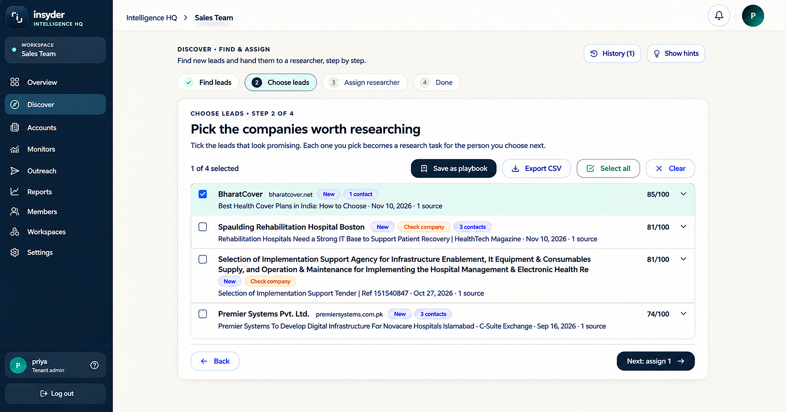

<div align="center">


# Insyder

**Account intelligence for revenue teams.**

Find the right accounts. See the evidence. Reach the people who decide.
Walk into every first meeting prepared.


</div>

<p align="center">
  
</p>

---

## Table of contents

- [About the project](#about-the-project)
- [Product features](#product-features)
- [Tech stack](#tech-stack)
- [Project structure](#project-structure)
- [Getting started](#getting-started)
- [Configuration](#configuration)
- [Available scripts](#available-scripts)
- [Site pages](#site-pages)
- [API reference](#api-reference)
- [Deployment](#deployment)

---

## About the project

This repository contains the **marketing website for Insyder**. Its "Book a demo"
form is handled by a server route inside the same Next.js app, which forwards each
request to the Insyder portal, where the platform admin sees it under
**Platform HQ → Demo requests**. There is no separate backend to deploy.

Insyder helps sales teams sell into change. It spots companies going through the
changes an offer depends on, shows the evidence behind each signal, finds the
people who make the decision, and briefs sellers on each account before they call.

It is built for technology sales teams, SDR teams, managed service providers,
agencies and channel partners.

> The Insyder product itself (sign-in and the app) lives in a separate repository,
> `insyder-portal`. The **Sign in** button on this site links to it.

## Product features

The site presents the five connected workflows of the Insyder product:

| Workflow | What it does |
| --- | --- |
| **Discover** | Describe the accounts you want in plain language. Insyder searches the web against your playbook, saves each match with its sources and hands it to a researcher. |
| **Monitor** | Saved playbooks that re-run research on a schedule you choose, within your research quota, and log every new signal they find. |
| **Accounts** | Your target accounts with their research status, buying signals, qualification brief and deals, from watchlist to sales acceptance to CRM. |
| **Contact profiling** | Find the IT and technology decision makers at an account, each with a source, and prepare for every conversation with a role hypothesis. |
| **Outreach** | Researchers, reviewers and SDRs work from one task list. Drafts come from reviewed evidence, outcomes are logged and handoffs stay clear. |

## Tech stack

- [Next.js 16](https://nextjs.org/) with the App Router
- [React 19](https://react.dev/) and [TypeScript 5](https://www.typescriptlang.org/)
- [react-icons](https://react-icons.github.io/react-icons/) for icons
- Plain CSS (`src/app/globals.css`), no CSS framework
- ESLint with `eslint-config-next`
- A Next.js route handler (`src/app/api/demo-requests/route.ts`) for the demo form, which runs as a serverless function on Vercel

## Project structure

```
Insyder/
└── frontend/                                Next.js marketing site
    ├── public/
    │   ├── assets/logo.svg                  Logo
    │   └── discover*.png                    Product screenshots
    └── src/
        ├── app/                             One folder per page, plus layout.tsx and globals.css
        │   └── api/demo-requests/route.ts   "Book a demo" handler (server-side)
        └── components/                      Header, Footer, Logo, DemoForm, GetStarted, LegalPage, nav
```

## Getting started

### Prerequisites

- [Node.js](https://nodejs.org/) **20 or newer**
- npm (comes with Node.js)

### 1. Clone the repository

```bash
git clone <repository-url>
cd Insyder
```

### 2. Start the site

Runs on **http://localhost:3001**.

```bash
cd frontend
npm install
cp .env.example .env.local   # first time only
npm run dev
```

Open **http://localhost:3001** in your browser.

### Notes

- The **Book a demo** form needs the portal's API running (port 4000) and
  `PORTAL_API_URL` and `DEMO_INTAKE_KEY` set in `frontend/.env.local`
  (see [Configuration](#configuration)). Every other page works without it.
- The **Sign in** button opens the login page of the Insyder portal (`insyder-portal`),
  which runs on http://localhost:3000. Start the portal as well if you want that button
  to work locally.

## Configuration

Settings live in `frontend/.env.local` (copy `frontend/.env.example` to start).
On Vercel, add the same variables under **Project → Settings → Environment Variables**.

| Variable | Example | Visible in browser | Description |
| --- | --- | --- | --- |
| `NEXT_PUBLIC_PORTAL_URL` | `http://localhost:3000` | Yes | Base URL of the Insyder portal (used by **Sign in**) |
| `PORTAL_API_URL` | `http://localhost:4000` | No | Portal API that receives demo requests |
| `DEMO_INTAKE_KEY` | (random secret) | No | Shared secret; must match `DEMO_INTAKE_KEY` in the portal's backend |

> Never give the last two a `NEXT_PUBLIC_` prefix: that would expose them to visitors.

## Available scripts

Run these inside `frontend/`.

| Command | Description |
| --- | --- |
| `npm run dev` | Start the development server on port 3001 |
| `npm run build` | Build the site for production |
| `npm start` | Serve the production build on port 3001 |
| `npm run lint` | Run ESLint |

## Site pages

| Route | Page |
| --- | --- |
| `/` | Home |
| `/product` | Product tour |
| `/discover` | Discover |
| `/monitor` | Monitor |
| `/accounts` | Accounts |
| `/contact-profiling` | Contact profiling |
| `/outreach` | Outreach |
| `/solutions` | Solutions by team |
| `/about` | About |
| `/demo` | Book a demo |
| `/privacy` | Privacy policy |
| `/terms` | Terms of service |

## API reference

Served by the Next.js app itself, on the same domain as the site.

| Method | Endpoint | Description |
| --- | --- | --- |
| `POST` | `/api/demo-requests` | Submit a demo request (forwarded to the portal) |

### `POST /api/demo-requests`

**Request body (JSON)**

| Field | Required | Max length | Notes |
| --- | --- | --- | --- |
| `name` | Yes | 120 | |
| `email` | Yes | 200 | Must be a valid email address |
| `company` | No | 200 | |
| `role` | No | 120 | |
| `website` | No | 300 | Must start with `http://` or `https://` |
| `message` | No | 2000 | |

**Example**

```bash
curl -X POST http://localhost:3001/api/demo-requests \
  -H "Content-Type: application/json" \
  -d '{"name":"Jane Doe","email":"jane@example.com","company":"Example Ltd"}'
```

**Responses**

- `201 Created`: `{ "ok": true, "id": "<id>" }`
- `400 Bad Request`: `{ "error": "<reason>" }` when validation fails
- `502` / `503`: `{ "error": "<reason>" }` when the portal can't be reached or isn't configured

### How demo requests reach the admin panel

```
Website form  →  /api/demo-requests (validates)  →  portal API  POST /v1/intake/demo-requests
                                                       (x-intake-key: DEMO_INTAKE_KEY)
                                                             ↓
                                            Portal database, table demo_requests
                                                             ↓
                                            Platform HQ → Demo requests (admin only)
```

The browser never talks to the portal directly; the shared key stays on the server.

## Deployment

The site deploys to **Vercel** as a single project with **Root Directory** set to `frontend`.

1. In the Vercel project, set `NEXT_PUBLIC_PORTAL_URL`, `PORTAL_API_URL` (the portal API's
   live address) and `DEMO_INTAKE_KEY` (the same value as in the portal's backend).
2. Redeploy, so the new variables take effect.

To run a production build locally:

```bash
cd frontend
npm install
npm run build
npm start
```
